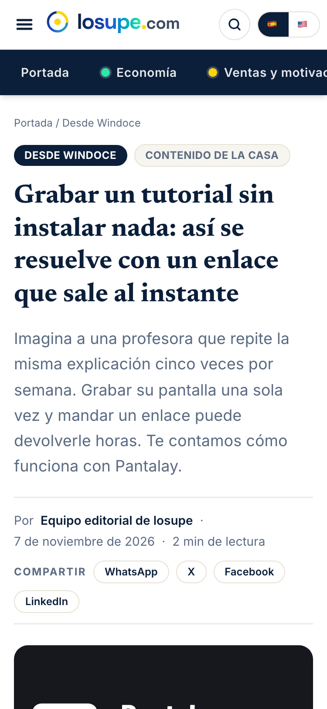
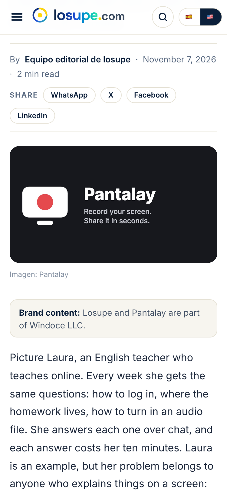
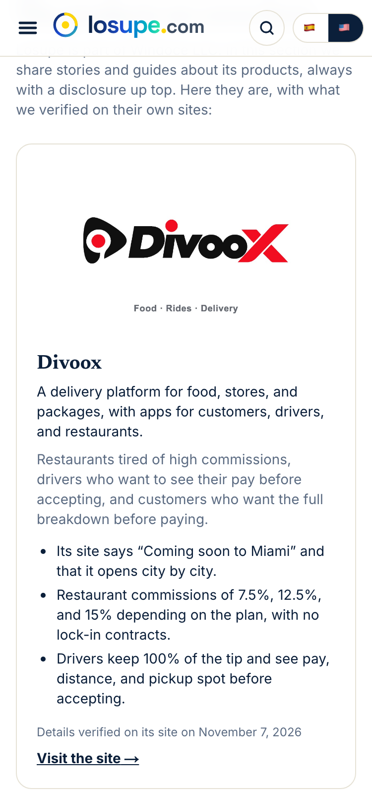

# Desde Windoce · guía / From Windoce · guide

> Español primero; la versión en inglés va debajo. Lo público (para lectores) vive en la Política
> editorial del sitio, sección «Contenido de la casa». Esto es el manual del equipo.

## Español

### Qué es

Una sección de Losupe con historias, lanzamientos, tendencias y guías sobre los productos de
Windoce LLC, la empresa dueña del medio. Estilo «vender sin vender». Reglas completas:
[DESDE-WINDOCE.md](DESDE-WINDOCE.md). Candado técnico: [candados.md](candados.md), número 57.

### Qué ve el lector

1. La etiqueta «Contenido de la casa» junto a la sección, arriba de la nota.
2. El primer párrafo, en un recuadro: «Contenido de la casa: Losupe y Pantalay son de Windoce LLC».
3. Un solo enlace al producto, al final.
4. En la portada de la sección, las fichas de los diez productos con la fecha en que se comprobó
   cada dato.

### Cómo se aprueba (Richard)

1. Panel → **Notas** → «Para revisar». Las de la casa llevan la etiqueta oscura «Desde Windoce».
2. **Abrir** para leerla. Debajo del título están los **Textos para redes**, listos para copiar.
3. **Publicar** = aprobarla: entra a la fila. El robot publica **una por día**, la más vieja primero.
4. **Descartar** si no sirve.
5. Después de cinco aprobadas, el robot deja las nuevas directamente en la fila (con su aviso).

### Cómo trabaja el robot

- Cada corrida, al final: si hoy no salió ninguna nota de la casa, publica la siguiente aprobada.
- Si hoy no escribió ninguna y hay menos de siete esperando revisión, escribe la siguiente de la
  rotación: diez productos y cuatro formatos (lanzamiento, historia de uso, tendencia, cómo).
- Solo usa lo que está en la ficha del producto. Rechaza solo las notas con cifras de usuarios,
  «compra ya», «caso real» u ofertas.

### Cuando cambia un producto

Se vuelve a leer su página y se actualiza su ficha en `src/lib/casa/productos.ts` con la fecha
nueva. Un producto nuevo de windoce.com se agrega al final de la lista y entra solo a la rotación.

## English

### What it is

A Losupe section with stories, launches, trends, and how-to guides about the products of Windoce
LLC, the company that owns the publication. The style is "selling without selling." Full rules:
[DESDE-WINDOCE.md](DESDE-WINDOCE.md). Technical lock: [candados.md](candados.md), number 57.

### What readers see

1. A "Brand content" label next to the section name at the top of the story.
2. The first paragraph, in a box: "Brand content: Losupe and Pantalay are part of Windoce LLC."
3. A single link to the product, at the end.
4. On the section page, cards for all ten products with the date each detail was verified.

### How approval works (Richard)

1. Panel → **Notes** → "To review." Brand stories carry the dark "From Windoce" tag.
2. **Open** to read it. Below the title you'll find the **Social media copy**, ready to paste.
3. **Publish** = approve it: it joins the queue. The robot publishes **one per day**, oldest first.
4. **Discard** if it's not right.
5. After five approvals, the robot puts new stories straight into the queue (with the disclosure).

### How the robot works

- At the end of every run: if no brand story went out today, it publishes the next approved one.
- If it hasn't written one today and fewer than seven are waiting for review, it writes the next
  one in the rotation: ten products and four formats (launch, use case, trend, how-to).
- It only uses what's in the product card, and rejects any story with user counts, "buy now,"
  "real customer story," or limited-time offers.

### When a product changes

Re-read its site and update its card in `src/lib/casa/productos.ts` with the new date. A new
product on windoce.com goes at the end of the list and joins the rotation automatically.

## Capturas / Screenshots

